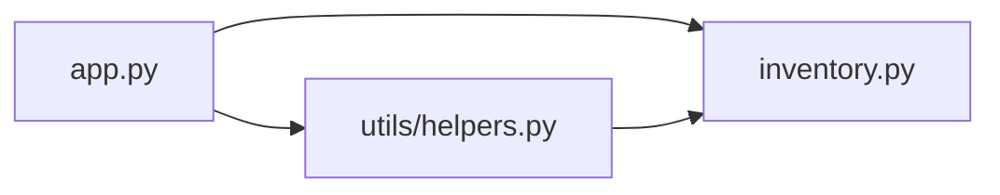

# Reverse Engineering Notes (v1.0)

Analysis of the Inventory Tracker as released in v1.0, before re-engineering.

## Functions and classes found

| Module | Classes / functions | What it does |
|---|---|---|
| `inventory.py` | `Item` (dataclass), `Item.value`, `get_items()`, `low_stock_items()`, `LOW_STOCK_THRESHOLD`, `_items` | Data model **and** the stock data itself (hard-coded list) |
| `utils/helpers.py` | `highest_stock_item()`, `lowest_stock_item()`, `money()` | Business rules mixed with a formatting helper |
| `app.py` | `total_stock_value()`, `print_table()`, `print_alerts()`, `main()` | Calculations **and** console output |

## Dependency diagram (v1.0)

`app.py` depends on both other modules, and `utils/helpers.py` also imports `Item` from `inventory.py`,
so a "utility" module is tied to the data module.

## Problems / code smells

1. **Data stored in code.** The stock list is a Python list inside `inventory.py`. Changing stock means editing
   source code, and changes are lost when the program stops.
2. **Mixed responsibilities.** `app.py` both calculates (`total_stock_value`) and prints. `inventory.py` is both
   the model and the data store. This makes the logic hard to reuse, for example from a web API.
3. **Coupling.** `utils/helpers.py` depends on `inventory.py`, so the helpers cannot be reused on their own.
4. **Business rules spread out.** Stock rules are split between `inventory.py` (low stock), `helpers.py`
   (highest/lowest) and `app.py` (total value).
5. **No external access.** The only interface is the console, so no other system can read or update stock.

## Plan for v2.0

- Split into `models.py`, `database.py`, `controllers.py`, `utils.py`, `api.py` and `cli.py`.
- Move the data to `data/inventory.json` and migrate it into a SQLite database.
- Expose the controllers through a FastAPI REST API.
- Package the migration, API and a test client as separate Docker containers with Docker Compose.
